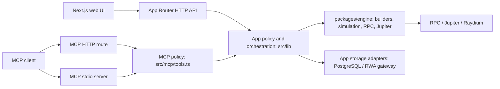

# SoFinance

Non-custodial Solana tooling for **Raydium CLMM** liquidity: zap any eligible wallet asset into a position via Jupiter, and compound fees/rewards back in—with the same safety gates for humans and AI agents.

One shared workspace engine in `packages/engine`, with application policies in `src/lib`, powers:

- a **Next.js web app** (wallet connect → quote → sign → broadcast)
- an **MCP server** (`src/mcp/`) that returns **unsigned v0 transactions** for agents to sign

The server never holds private keys. Agents/users sign locally; broadcast re-verifies an HMAC permit and re-simulates before send.

The marketing landing page lives at `/`. Product UI lives under `/app` (Positions, Plan, RWA pairs, position performance, Use AI, and sign deep-links). `/api/*` is unchanged.

| Old path | New path |
|----------|----------|
| `/` (app home) | `/app` |
| `/rwa-pairs` | `/app/rwa-pairs` |
| `/position-performance` | `/app/position-performance` |
| `/ai` | `/app/ai` |
| `/sign/<token>` | `/app/sign/<token>` |

Former page paths permanently redirect. MCP `prepare_*` tools now emit `/app/sign/<token>`.

**Docs:** [Self-hosting](#self-hosting) · [Security policy](SECURITY.md) · [Changelog](CHANGELOG.md)

## Quick start for judges

- **Live app:** https://sofinancelab.xyz
- **Demo video:** https://www.youtube.com/watch?v=vVW_z4Iiw8Y
- **Official X:** https://x.com/SoFinancelab
- **Colosseum project:** https://colosseum.com/arena/projects/16410

### How Solami is used

- **Solami RPC** (`packages/engine/src/rpc/providers.ts`, `packages/engine/src/rpc/urls.ts`): with the default provider configuration, `SOLAMI_API_KEY` selects `https://rpc.solami.dev/sol` as primary; eligible failures fall back to another provider. `SOLANA_RPC_PROVIDERS` can override this with an explicit pool. Position performance discovers history via Solami `getTransactionsForAddress` (`src/lib/solami/history.ts`, `src/lib/position-performance-math.ts`).
- **Data API / Blur** (`src/lib/solami/blur.ts`, `src/app/api/pool-activity/`, `src/components/pool-activity-panel.tsx`): `SOLAMI_DATA_API_KEY` powers the live pool-trades panel (REST snapshot + WebSocket stream of decoded swaps) and the Blur-priced in-range status (`src/lib/position-range-status.ts`). Also exposed to agents as an MCP tool (`src/mcp/tools.ts`).
- **Beam** (`packages/engine/src/solami/beam.ts`, `packages/engine/src/open-atomic.ts`): the single atomic open-position tx gets a 100k-lamport Beam tip when it fits. The tip is skipped (`skippedReason: "oversize"`) if adding it would push the tx over 1232 bytes, e.g. SOL input or MSTR pools. Landing info is read back via `/api/beam-landing`. Compound and selected flows use the same logic.

### Run locally

Requires Node 24 (`.node-version`, matching CI and the service Docker image) and pnpm 10.18.2 (`packageManager` in `package.json`).

```bash
corepack enable
pnpm install
cp .env.example .env.local   # fill in your own keys
pnpm dev                     # http://localhost:3000
```

Solami env vars (server-only, never prefix with `NEXT_PUBLIC_`):

| Variable | Purpose |
|----------|---------|
| `SOLAMI_API_KEY` | Solami RPC + Beam. Unset = `SOLANA_RPC_URL`, else public mainnet RPC. |
| `SOLAMI_BEAM` | Set to `0` to keep Solami RPC but skip Beam tips. |
| `SOLAMI_DATA_API_KEY` | Blur REST/WS for the pool-trades panel. Free keys have REST only; WebSocket needs Pro. |

To use your own key, create one at Solami and put it in `.env.local`. Other variables (`JUPITER_API_KEY`, `NEXT_PUBLIC_REOWN_PROJECT_ID`, `NEXT_PUBLIC_APP_URL`, …) are documented in `.env.example`.

### If the Solami trial key has expired

The deployed app uses a Solami Pro trial key that may expire. What the code does then:

- **Blur panel:** shows as unavailable / snapshot-only instead of live trades; the rest of the app keeps working.
- **RPC:** reads and sends fall back to `SOLANA_RPC_URL`/public RPC on validation, 5xx, 429 / JSON-RPC `-32005`, timeout, and auth/plan errors (401/402/403). Re-broadcasting the same signed transaction is idempotent. A short circuit-breaker skips a dead primary so every subsequent call is not retried there first. Removing `SOLAMI_API_KEY` switches everything to `SOLANA_RPC_URL` or public RPC (no Beam tip).
- **Beam:** the tip is optional; if no tip address is available the tx is built without it.

## Self-hosting

Run your own instance of the Next.js app (web UI + `/api/*` + remote MCP). This is the same flow as [Run locally](#run-locally) with env, build, Docker, and MCP client notes spelled out.

### Clone and install

Requires Node 24 and pnpm 10.18.2 (`packageManager` in `package.json`).

```bash
git clone https://github.com/truenorth-lj/sofinance-public.git
cd sofinance-public
corepack enable
pnpm install
cp .env.example .env.local   # fill in your own keys; never commit this file
```

### Environment

Copy `.env.example` → `.env.local`. Comments in that file are the source of truth. Do not prefix server secrets with `NEXT_PUBLIC_`.

**Typically required for a useful instance**

| Variable | Role |
|----------|------|
| `JUPITER_API_KEY` | Jupiter quotes plus HMAC secret for permits, sign tokens, and MCP tokens |
| `NEXT_PUBLIC_REOWN_PROJECT_ID` | Wallet connect in the web UI ([Reown dashboard](https://dashboard.reown.com/)) |
| `NEXT_PUBLIC_APP_URL` | Absolute MCP and sign-link URLs (local: `http://localhost:3000`; production auto-detects `VERCEL_URL`) |

**RPC (pick a path)** — `SOLAMI_API_KEY` (optional, preferred) and/or `SOLANA_RPC_URL`. If both are unset, server RPC uses public mainnet.

**Optional**

| Variable | Role |
|----------|------|
| `SOLAMI_BEAM` | `0` keeps Solami RPC but skips Beam tips |
| `SOLAMI_DATA_API_KEY` | Blur live pool-trades panel |
| `NEXT_PUBLIC_SOLANA_RPC_URL` | Browser wallet RPC only; must be a public endpoint, never a key |
| `SOFINANCE_FEE_WALLET` / `SOFINANCE_FEE_BPS` | Optional protocol fee; **server-only, never `NEXT_PUBLIC_`**. Default 10 bps, max 100. Unset wallet = fee 0, no transfer added. Details: [Protocol swap fee](#protocol-swap-fee). |
| RWA / history DB vars | Explicit `gateway` (default) or direct TLS `neon` mode; native cron defaults off. See `.env.example`, [DB docs](db/README.md) and [cutover runbook](db/neon-vercel-cutover.md) |
| `NEXT_PUBLIC_SENTRY_DSN` / `SENTRY_DSN` | Optional Sentry error monitoring (US, `ingest.us.sentry.io`). Unset both = complete no-op. |
| `SENTRY_AUTH_TOKEN` / `SENTRY_ORG` / `SENTRY_PROJECT` | Source-map upload on `next build`. All three required to upload; build succeeds if any is missing. Never `NEXT_PUBLIC_`. See [Error monitoring](#error-monitoring-sentry). |
| `NEXT_PUBLIC_POSTHOG_KEY` / `NEXT_PUBLIC_POSTHOG_HOST` | Optional PostHog product analytics. Unset key = complete client no-op. The browser always sends to the first-party relay `/lumen` (Next.js rewrite); the host only picks the upstream region and defaults to `https://us.i.posthog.com`. |
| `SOFINANCE_OPENS_DATABASE_URL` | Optional Postgres URL (Neon / Vercel Postgres) for north-star open logs. Unset = log nothing. Not the Zeabur RWA `DATABASE_URL`. |
| `SOFINANCE_OPENS_READ_TOKEN` | Bearer token (≥32 chars) for `GET /api/internal/opens-daily`. Unset = route 404s. |

See [Growth analytics](#growth-analytics) for event names and the internal read endpoint.

### Run

```bash
pnpm dev                     # http://localhost:3000
pnpm lint && pnpm typecheck && pnpm test && pnpm build
pnpm start                   # after build
```

`pnpm mcp:start` runs the local stdio MCP server (needs `SOLANA_RPC_URL` and `JUPITER_API_KEY` in the environment).

### Docker

The `Dockerfile` builds the **optional RWA snapshot data service** (`scripts/rwa-data-service.ts`), not the Next.js web app. It needs `DATABASE_URL` and a `CRON_SECRET` of at least 32 characters.

```bash
docker build -t sofinance-rwa-service .
docker run --env-file .env.local -p 3000:3000 sofinance-rwa-service
```

The web UI and MCP HTTP endpoint are the Next.js app (`pnpm dev` / `pnpm build && pnpm start`, or Vercel).

### Error monitoring (Sentry)

Optional `@sentry/nextjs` client, server, and edge setup. The production/preview project is **sofinance / sofinance-public** in the US region (`ingest.us.sentry.io`).

| Variable | Role |
|----------|------|
| `NEXT_PUBLIC_SENTRY_DSN` | Browser + bundled client DSN. Unset with `SENTRY_DSN` = SDK is disabled. |
| `SENTRY_DSN` | Server/edge DSN fallback if the public var is unset. |
| `NEXT_PUBLIC_SENTRY_TRACES_SAMPLE_RATE` / `SENTRY_TRACES_SAMPLE_RATE` | Trace sample rate 0–1 (default `0.1`). |
| `SENTRY_AUTH_TOKEN` | Source-map upload token. Server-only; never `NEXT_PUBLIC_`. |
| `SENTRY_ORG` | Sentry org slug (`sofinance`). |
| `SENTRY_PROJECT` | Sentry project slug (`sofinance-public`). |

Session Replay is off. `sendDefaultPii` is false. Events scrub wallet addresses, signatures, RPC URLs, API keys, `x-vercel-*` / IP / `Authorization` / `Cookie` headers, and drop `user.ip_address`. API captures are 5xx and Jupiter/RPC upstream only (not validation 4xx or user-rejected). The `route` tag comes from the request path / Next transaction, not a bundled stack.

### Point an MCP client at your instance

1. Set `NEXT_PUBLIC_APP_URL` to the origin you will expose (for example `http://localhost:3000` or `https://your-host.example`).
2. Start the Next.js app. On `/app/ai`, use **Sign to get MCP config**.
3. In the generated config, use your origin instead of production:

```json
{
  "mcpServers": {
    "sofinance": {
      "url": "https://your-host.example/api/mcp",
      "headers": {
        "Authorization": "Bearer <your-token-here>"
      }
    }
  }
}
```

Local stdio against this checkout: see [Quickstart — MCP for AI Agents](#quickstart-mcp-for-ai-agents-remote-zero-local-secrets) (Option B shim with `SOFINANCE_MCP_URL`, or Alternative: Local MCP with `pnpm mcp:start`).

## Features

- Discover Raydium CLMM position NFTs and eligible ATA / native SOL balances
- **Add-liquidity zap**: Jupiter Swap V2 + Raydium `increase_liquidity_v2` in one simulated v0 tx
- Configurable **add-liquidity price tolerance** (default 1%, cap 5%) so pool drift does not trip Raydium `PriceSlippageCheck` (6017); unused reserve stays in the wallet
- **Resale-ratio floor** (default 99%): conservative quote of swapping position outputs back to the same input asset
- **One-click compound**: harvest fees/rewards, swap to range ratio, reinvest (phase one rejects third reward mints without a verifiable path)
- Web UI Advanced settings for resale gap and price tolerance; MCP exposes the same knobs
- **Position performance / realized fee APR**: holding-period return from on-chain open/increase/decrease events + current equity (not Raydium pool 24h feeApr). Same-asset RWA pairs prefer **token-equivalent (TE)** in the plain/base ticker via current tick mid (raw A/B + TE; USD secondary) — MCP `get_position_performance`, `/api/position-performance`, `/app/position-performance` UI
- **Live pool activity (Solami Blur)**: pool stats, swap ticker (Solscan links), and live in-range / near-edge status from the latest Blur price versus the position ticks — `/app` + `/app/position-performance`, MCP `get_pool_activity` / `get_position_range_status`
- **Same-asset RWA pair discovery**: Raydium CLMM pools where both sides are the same underlying (e.g. `MSTRx`/`MSTR`, `NVDAx`/`NVDA`), filtered by Jupiter Tokens API tags (`stocks`|`rwa`) plus Backed xStocks whitelist, with fee tier, TVL, 24h volume/fees, estimated fee APR, Token-2022 / freeze flags — MCP `list_rwa_pairs` and `/app/rwa-pairs` UI
- **Open CLMM position**: create a new Raydium concentrated position from `/app/rwa-pairs` (Add liquidity) or MCP `quote_open_position` / `prepare_open_position` / `submit_open_position`, with Jupiter swap-to-ratio, range presets (web UI adds a **Micro** band, an estimated fee APR per preset, and an **Best** button that picks the candidate with the highest estimated APR; see `docs/rwa-range-apr.md`), and the same quote → prepare → sign → re-sim gates. No need to open the NFT on raydium.io first. The position NFT mint is an ephemeral server-side Keypair: it partial-signs the v0 message after the fresh blockhash restamp, then the secret is zeroed in memory and never logged or persisted. The wallet signs as fee payer; `/app/sign/<token>` restores that extra signature if the wallet drops it. Dedicated `submit_open_position` (not `submit_signed_transaction`) because this message has two required signers.

## Safety gates

Kept on both web API and MCP paths:

| Gate | Role |
|------|------|
| Price-impact cap | 5% vs probe route (`MAX_PRICE_IMPACT_BPS`) |
| Resale-ratio floor | 95–100% in 0.1% steps (default 99%) |
| Jupiter swap slippage | Fixed 0.5% |
| Add-liquidity tolerance | 0–5% (default 1%); pads `amountMax`, shrinks liquidity |
| 1,232-byte limit | Rejects oversized v0 messages |
| Full simulation | Exact liquidity delta + balance checks before signing |
| HMAC permit | Binds message, wallet, selection, amounts, floor, starting state |
| Re-verify | On submit: permit, on-chain state, re-simulate, then broadcast |

## MCP tools (16)

| Tool | Purpose | Key params |
|------|---------|------------|
| `get_position_performance` | Holding-period / fee APR from chain; TE for same-asset RWA wrap pairs | `positionMint`, `wallet?`, `maxSignatures?`, `skipPricing?` |
| `get_pool_activity` | Live Solami Blur pool snapshot + recent swaps (`available: false` without a data key) | `poolId`, `limit?` |
| `get_position_range_status` | In/out of range from Blur pool price vs position ticks; near-edge flag | `positionMint`, `wallet?`, `poolId?` |
| `list_positions` | Positions + eligible assets | `wallet` |
| `quote_add_liquidity` | Read-only zap quote | `wallet`, `positionMint`, `inputMint`, `inputKind` (`native`\|`token`), `amount`, `resaleFloorBps?` (9500–10000, default 9900), `slippageToleranceBps?` (0–500 step 10, default 100) |
| `prepare_transaction` | Unsigned zap tx + permit + `submitArgs` + `signUrl` | same as quote |
| `submit_signed_transaction` | Permit check → re-sim → broadcast | `signedTransaction` + every `submitArgs` field unchanged |
| `quote_compound` | Compound quote | `wallet`, `positionMint`, `sourceSignatures?` (≤3) |
| `prepare_compound_transaction` | Unsigned compound tx + permit + `signUrl` | same as quote_compound |
| `submit_compound_transaction` | Permit check → re-sim → broadcast | `signedTransaction`, `permit`, `wallet`, full `summary` unchanged |
| `list_rwa_pairs` | Discover same-asset RWA pairs; includes `openPositionUrl` + `recommendedRanges`. Defaults `maxPages=3`; uses the in-memory cache when warm | `minTvl?`, `maxPages?`, `sortBy?` |
| `quote_open_position` | Quote a **new** CLMM position (no existing NFT) | `wallet`, `poolId`, `inputMint`, `inputKind`, `amount`, `rangePreset?` (`tight`\|`standard`\|`wide`\|`custom`), `minPrice?`/`maxPrice?` (B per 1 A) |
| `prepare_open_position` | Unsigned open-position tx + permit + `signUrl` (NFT mint partial-signed) | same as quote_open_position |
| `submit_open_position` | Permit check → re-sim → broadcast (two signers: wallet + NFT mint) | `signedTransaction`, `permit`, `wallet`, full `summary` unchanged |
| `prepare_withdraw` | Simulated withdrawal + permit + sign link; supports two-stage withdrawal | `wallet`, `positionMint`, `percent` or `targetUSDC`, `receive?`, `outputMint?`, `confirmHighImpact?`; second stage: `stage=swap`, `tx1Signature`, complete `previous` result |
| `submit_withdraw` | Permit/signature/expiry check → re-sim → broadcast | `wallet`, `signedTransaction`, `permit`, full `summary` unchanged, `confirmHighImpact?` |

## Quickstart — web

```bash
pnpm install
cp .env.example .env.local
# Server-only: SOLANA_RPC_URL and/or SOLAMI_API_KEY, JUPITER_API_KEY
# Optional: SOLAMI_DATA_API_KEY (Blur; unused until the pool-activity layer)
# Optional protocol fee: SOFINANCE_FEE_WALLET + SOFINANCE_FEE_BPS (default 10, max 100). Unset wallet = fee 0.
# Public: NEXT_PUBLIC_REOWN_PROJECT_ID (and optional NEXT_PUBLIC_SOLANA_RPC_URL without secrets)
pnpm dev --webpack --hostname 127.0.0.1
```

```bash
pnpm lint && pnpm typecheck && pnpm test && pnpm build
```

Never commit `.env.local`, mnemonics, or API keys. Do not prefix `SOLANA_RPC_URL` / `SOLAMI_API_KEY` / `SOLAMI_DATA_API_KEY` / `JUPITER_API_KEY` / `SOFINANCE_FEE_WALLET` / `SOFINANCE_FEE_BPS` with `NEXT_PUBLIC_`.

### Protocol swap fee

Implementation and detailed audit: [shared swap module](src/lib/swap/README.md).

When `SOFINANCE_FEE_WALLET` is set (Vercel env, server-only), fee-enabled open-position and compound swaps take `SOFINANCE_FEE_BPS` (default 10, max 100) of that swap’s input inside the same atomic v0 transaction the wallet signs. Unset wallet keeps fee 0. A floored-zero fee adds no transfer and no recipient ATA.

- Open position (Jupiter): fee is an SPL/SOL transfer of the input asset; the Jupiter `/build` amount is the net after the fee. Resale-floor probes are not charged.
- Selected-position add: no protocol fee is currently collected. Sequential open charges the primary conversion only; direct same-mint legs and secondary conversions remain fee-free.
- One-click compound (Raydium): fee is an SPL transfer from the isolated swap-input account after harvest, before the in-pool SPCXx↔SPCX rebalance.

Quote/prepare JSON includes `feeBps` / `feeAmount` / `feeWallet`. Rent estimates are unchanged; ATA rent for a new recipient token account is allowed in the simulated SOL debit cap only.

## Powered by Solami

[Solami](https://solami.dev) is optional Solana infrastructure. Bring your own keys — the app keeps working on `SOLANA_RPC_URL` or the public mainnet RPC when they are absent.

| Surface | When | What it does |
|---------|------|----------------|
| **RPC** | `SOLAMI_API_KEY` set | All server RPC (`rpcConnection()` / `rpcRequest()`) goes through `@sofinance/engine/rpc` (Solami → `SOLANA_RPC_URL` / Helius → public). 429 / 5xx / timeouts retry on the same provider with exponential backoff + jitter (honors `Retry-After`, bounded budget, `AbortSignal`), then fail over. Auth/plan errors (401/402/403) and JSON-RPC `-32005` skip same-provider retry and fail over immediately, including simulate / blockhash / height / fee / send / confirm. Re-broadcasting the same signed transaction is idempotent by signature. A short circuit-breaker then skips the dead primary until a small cooldown elapses. Exit-preview uses a longer 25s per-call budget and coalesces identical position reads for 8s. Safe reads (`getAccountInfo`, `getMultipleAccounts*`, `getTokenLargestAccounts`, finalized/confirmed `getParsedTransaction`) use a small in-process TTL cache with in-flight de-dupe — never sends, simulates, or blockhash/height calls. Methods Solami answers non-compliantly (`getEpochInfo.transactionCount=null`, `getParsedTransaction` jsonParsed unions) still fall back per `METHOD_POLICIES`. History listing uses Solami `getTransactionsForAddress`; empty / HTTP / parse failures use the same policy layer. Fallback reasons are always logged as key-free JSON; set `SOFINANCE_RPC_LOG=1` for per-attempt lines. |
| **Jupiter** | `JUPITER_API_KEY` (Portal) | All Jupiter HTTP goes through `packages/engine/src/jupiter/` to `https://api.jup.ag` with `x-api-key` (`lite-api.jup.ag` is retired). 429 / 5xx / timeouts retry with jitter + `Retry-After` / `x-ratelimit-reset`, bounded budget, `AbortSignal`. Read-only quotes cache 8s (key: input/output mint, amount, slippage, maxAccounts) with in-flight de-dupe; POST `/swap-instructions` is not cached. Exit-preview quotes legs in parallel (cap 2) and logs the real error class/message on failure (always-on, key-free). Upstream Jupiter 429/5xx return `errorCode: "jupiter_unavailable"` — not the Solana RPC text. `SOFINANCE_JUPITER_LOG=1` or `SOFINANCE_RPC_LOG=1` logs per-call Jupiter lines. |
| **Blur** | `SOLAMI_DATA_API_KEY` | Live pool activity. REST snapshot at `GET /api/pool-activity?poolId=` (`/data/pool` for mint + `GET /data/token/trades?chain=solana&address=<MINT>`, then client-filter by exact `pool`). SSE at `/api/pool-activity/stream` proxies Blur WS `type=swap,liquidity&pool=<POOL>` (never `address=` — that is a mint filter), forwards only parsed swap/liquidity events, and closes before Vercel `maxDuration` so the browser can reconnect. If the data plan is unavailable (401/402/403/429, empty pool payload, or a Free-tier socket that closes before `connected`) the UI hides the live ticker and, when there is no snapshot, the whole pool-activity section. Without the key the UI hides the panel. |
| **Beam** | `SOLAMI_API_KEY` (off with `SOLAMI_BEAM=0`) | Prepare adds a ≥100,000-lamport SystemProgram tip to a live tip address **before** HMAC binding so the user signs it. If the v0 message would exceed 1,232 bytes the tip is omitted. Broadcast is the same `sendRawTransaction` through Solami RPC. After submit we poll `GET /swqos/tx/{signature}` up to ~6s and always return `beamLandingUrl` so clients can refresh. |

Create a key at [solami.dev](https://solami.dev). Paste `SOLAMI_API_KEY` (and later `SOLAMI_DATA_API_KEY`) into `.env.local` or Vercel — never `NEXT_PUBLIC_*`. Position performance reports `{ txCount, elapsedMs, provider, solamiTxCount, defaultTxCount, fallbackReasons }` so you can see when Solami served recent txs and the default RPC filled older or unparseable ones.

```
wallet / API / MCP
        │
        ▼
 packages/engine/src/rpc/ ── SOLAMI_API_KEY? ──► rpc.solami.dev
        │                    else ──► SOLANA_RPC_URL / public RPC
        │         retry 429/5xx/timeout → then next provider
        │         cache safe reads (per-instance, best effort)
        ▼
 position-performance / exit-preview / MCP
   solami: getTransactionsForAddress (signatures page) + batched getParsedTransaction
   fallback: SOLANA_RPC_URL / public (empty window, parse errors, HTTP 5xx/429/-32005/401–403 after retry)
   default: getSignaturesForAddress + batched getParsedTransaction (8-wide)
```

### Demo checklist (RPC layer)

1. Set `SOLAMI_API_KEY` only (no `SOLANA_RPC_URL`) and open `/app/position-performance`.
2. Compute performance for a real mainnet position NFT.
3. Confirm the history line shows a tx count / elapsed ms and either `solami` or `Solami for recent / fallback for older` (Solami's history window is limited; older txs come from the default RPC automatically).
4. Unset the key, restart, and confirm the same page still works via `SOLANA_RPC_URL` / public RPC with `provider: default`.
5. Set `SOLAMI_DATA_API_KEY`, open `/app` on a position, and confirm the Live pool activity panel (stats + Solscan ticker). A Free key fills the snapshot; Pro unlocks the SSE ticker. The demo Raydium CLMM SPCXx/SPCX pool `DUzBLHZ5RZdftPuWVijsvjupndogRM1adGJpsR7YTJro` (mint `Xs3oZwbHvqis4NYcf4YKWmEia2eC84wSiVrcYcTqpH8`) is often quiet — empty-state is expected; the global `dex=raydium_clmm` Blur stream is busy for sanity checks. Quiet pools still send SSE heartbeat comments.
6. Confirm `/app/position-performance` shows the same panel plus in-range / approaching-edge from Blur price vs ticks.
7. Unset the data key and confirm the panel disappears (no error banner).
8. With `SOLAMI_API_KEY` set, prepare a zap/compound/open and confirm the unsigned message includes a tip transfer (or is omitted only because of the 1,232-byte cap). After broadcast, the status dialog / MCP submit result may show `Landed via Beam · region · tip`.
9. Set `SOLAMI_BEAM=0` and confirm prepares still work with no tip.

## Quickstart — MCP for AI Agents (Remote, Zero Local Secrets)

**Recommended:** Use the remote MCP endpoint with zero local secrets. The MCP server runs on Vercel; your laptop needs only a connection URL + auth token.

### Getting Started (Remote MCP)

1. **Connect your wallet** on [sofinancelab.xyz/app](https://sofinancelab.xyz/app) (or `/app/ai`)
2. **Click "Sign to get MCP config"** — a WalletConnect session is not ownership proof. Each challenge nonce is single-use in-process (2-minute window). Vercel isolates do not share that store; a replay on a different isolate can still mint until the window expires.
3. **Sign the challenge message** in your wallet (proves you control the key)
4. **Copy the generated config** — includes a short-lived token bound to your wallet
5. **Paste into your AI agent:**

   **Cursor / Claude (if HTTP MCP supported):** Use the direct HTTP config

   **Cursor / Claude (if stdio only):** Use the zero-secret shim config

The UI shows both configs after you sign. Choose based on what your agent supports.

### Option A: Direct HTTP (Preferred)

If Cursor/Claude supports HTTP MCP with custom headers:

```json
{
  "mcpServers": {
    "sofinance": {
      "url": "https://sofinancelab.xyz/api/mcp",
      "headers": {
        "Authorization": "Bearer <your-token-here>"
      }
    }
  }
}
```

### Option B: Zero-Secret Shim (Fallback)

If your agent only supports stdio, use this shim that requires ZERO RPC/Jupiter secrets:

```json
{
  "mcpServers": {
    "sofinance": {
      "command": "npx",
      "args": ["tsx", "src/mcp/remote-shim.ts"],
      "cwd": "/absolute/path/to/sofinance-public",
      "env": {
        "SOFINANCE_MCP_URL": "https://sofinancelab.xyz/api/mcp",
        "SOFINANCE_MCP_TOKEN": "<your-token-here>"
      }
    }
  }
}
```

**Benefits:**
- ✅ Zero local secrets (no SOLANA_RPC_URL or JUPITER_API_KEY on laptop)
- ✅ Signature-verified tokens (prove wallet ownership before minting)
- ✅ Always up-to-date (talks to production Vercel backend)
- ✅ Short-lived tokens (24h expiry, regenerate anytime)
- ✅ Wallet-bound auth (token only works for your wallet)

**Agent flow:** `list_positions` → `quote_add_liquidity` → `prepare_transaction` → wallet signs locally → `submit_signed_transaction`. Open a new RWA position: `list_rwa_pairs` → `quote_open_position` → `prepare_open_position` → sign via `signUrl` → `list_positions`. Server never holds your private keys.

### Alternative: Local MCP (Power Users)

For local development or testing, you can run the MCP server locally:

```bash
pnpm install
pnpm mcp:start  # Requires SOLANA_RPC_URL and JUPITER_API_KEY in env
```

Cursor / Claude config for local stdio:

```json
{
  "mcpServers": {
    "sofinance": {
      "command": "npx",
      "args": ["tsx", "src/mcp/server.ts"],
      "cwd": "/absolute/path/to/sofinance-public",
      "env": {
        "SOLANA_RPC_URL": "https://your-solana-rpc",
        "JUPITER_API_KEY": "your-jupiter-key",
        "NEXT_PUBLIC_APP_URL": "https://sofinancelab.xyz"
      }
    }
  }
}
```

Or: `pnpm mcp:start` with env already exported.

**Agent flow:** `list_positions` → `quote_add_liquidity` → `prepare_transaction` → wallet signs `unsignedTransaction` → `submit_signed_transaction` with `{ signedTransaction, ...submitArgs }`. Compound: `quote_compound` / `prepare_compound_transaction` → sign → `submit_compound_transaction` with the complete `summary`. Open position: `list_rwa_pairs` → `quote_open_position` → `prepare_open_position` → sign → `submit_open_position` with the complete `summary`.

**Sign deep-link:** After `prepare_transaction`, `prepare_compound_transaction`, or `prepare_open_position`, the agent receives a `signUrl` (e.g. `https://sofinancelab.xyz/app/sign/<token>`) that can be opened in a browser. Legacy `/sign/<token>` URLs permanently redirect to `/app/sign/<token>`. The token is a self-contained, HMAC-signed, compressed payload containing the unsigned transaction, permit, and submit arguments. With the correct wallet connected via Reown AppKit, the user reviews the transaction summary and signs with one click. The signed transaction is automatically submitted via the existing re-verification and broadcast paths. This bridges the gap for agents that can prepare transactions but delegate signing to the user's wallet UI. Sign tokens expire after 60-120 seconds (matching permit/blockhash lifetime). The token is verified server-side using `JUPITER_API_KEY` as the HMAC secret, so MCP (local/remote) and Vercel (production) can share the same signing mechanism without shared memory.

`JUPITER_API_KEY` is used for Jupiter swap quotes, permit HMACs, sign token HMACs, and MCP token HMACs. Quotes expire quickly; always re-prepare before signing.

## Growth analytics

Optional. Local dev, forks, and tests stay a no-op until the PostHog key and/or opens database URL are set.

**PostHog (browser, `posthog-js`)** — init only when `NEXT_PUBLIC_POSTHOG_KEY` is set. Autocapture, heatmaps, web vitals, surveys, and session recording off; Do Not Track respected. Requests go to `/lumen/*` on our own domain, which `next.config.ts` rewrites to PostHog (`us.i.posthog.com` for events, `us-assets.i.posthog.com` for `/static` and `/array`), so ad blockers that block `*.posthog.com` don't drop events. `/lumen` is excluded from the Proxy matcher and disallowed in `robots.txt`. First-touch `ref` (`?ref=x-<slug>`) and `utm_*` are stored in localStorage and registered as PostHog super/person properties so later events keep attribution.

| Event | When | Properties |
|-------|------|------------|
| `$pageview` | App Router route changes (including `/` and `/app/rwa-pairs`) | `$pathname`, `$current_url` |
| `rwa_pairs_view` | Landing on `/app/rwa-pairs` | `ref` if present on that URL |
| `wallet_connect_clicked` | User opens the wallet picker (any Connect wallet button) | none |
| `wallet_connected` | Wallet connects (also on auto-reconnect after a hard load) | none (identify uses `wallet:<sha256>`, not the address) |
| `performance_view` | Performance tab shown in `/app` (tab click or `?view=performance` deep link); the URL doesn't change, so `$pageview` can't see it | none |
| `open_position_started` | User starts an open (prepare/sign) | `pool`, `pair` when known |
| `open_position_success` | Open confirmed on-chain via `/api/open-status` | `pool`, `pair` |
| `open_position_failed` | Open failed before send, or on-chain failed/expired | `error_class` only (never raw error text) |

**North-star opens log (server)** — after a successful open broadcast (`/api/open-broadcast` and MCP `submit_open_position`), best-effort insert into Postgres: UTC time, wallet, pool, pair symbols, USDC notional when the input is USDC, tx signature (unique), `sourceRef` if the client sends the first-touch `ref`. Failures never delay or fail the broadcast. Idempotent DDL: `src/lib/opens-log/schema.sql` (also applied on first write).

Read path (GTM):

```bash
curl -sS -H "Authorization: Bearer $SOFINANCE_OPENS_READ_TOKEN" \
  "https://sofinancelab.xyz/api/internal/opens-daily?days=90"
curl -sS -H "Authorization: Bearer $SOFINANCE_OPENS_READ_TOKEN" \
  "https://sofinancelab.xyz/api/internal/opens-daily?days=90&format=csv"
```

JSON fields per UTC day: `opens`, `uniqueWallets`, `newUniqueWallets`, `notionalUsd`, `byRef[]`. The fee wallet is not included.

## Architecture



The app owns HTTP/MCP authorization, permits around app-specific flows, pending attempts,
recovery, persistence and UI state. `packages/engine` owns reusable transaction builders and
provider clients; `src/lib/engine-host.ts` supplies its host configuration. Some HTTP/MCP
orchestration is still duplicated; consolidating those use cases is the next refactor stage.

Stack: Next.js 16 / React 19 / TypeScript / pnpm / Vitest; `@raydium-io/raydium-sdk-v2`, Jupiter `/swap/v2/build`, `@solana/web3.js`, Zod, MCP SDK.

### RPC provider layer

Callers import `rpcConnection()`, `rpcReadConnection()` or `rpcRequest()` from
`@sofinance/engine/rpc`. Provider selection, retries, method policies, per-provider rate limits
and safe-read caching live in `packages/engine/src/rpc/`. Reads may use weighted provider
rotation; eligible failures can fall back across providers, including sends of the same signed
transaction. A later retry rejection does not prove that an earlier send was never accepted;
app attempt recovery retains the original signature until reconciliation.

Configure a provider pool with `SOLANA_RPC_PROVIDERS`; see the maintained
[engine RPC provider documentation](packages/engine/README.md#rpc-provider-pool) for default
routing, method capabilities, retry and cache policies. Add provider policy in that package,
not in individual quote/send/MCP callers. The cache is per process; `RpcCacheStore` is the
extension point for a shared store.

App-specific Blur HTTP and history parsing remain in `src/lib/solami/`; Beam transaction
helpers live in `packages/engine/src/solami/beam.ts`.

## RWA same-asset pairing

Discovers Raydium CLMM pools via the official API (`/pools/info/list?poolType=concentrated`) where both mints are the same underlying asset:

1. **Structural**: symbols form a wrap pair `FOOx`/`FOO`, `FOO-x`/`FOO`, or `xFOO`/`FOO` (stablecoin bases excluded)
2. **Primary**: both mints have Jupiter Tokens API tags including `stocks` **or** `rwa` (`GET /tokens/v2/search?query={mint}`; optional `JUPITER_API_KEY`). Preferred tags `xstocks` / `backpack` are noted when present but not required
3. **Secondary**: Backed xStocks public assets whitelist (`https://api.xstocks.fi/api/v2/public/assets`, Solana deployments) so known Backed mints still qualify if Jupiter tags lag

Name heuristics are not used as the primary filter. Annotated with fee tier, TVL, 24h volume/fees, Raydium `feeApr`, and **estimated fee APR** = `(24h fees / TVL) × 365 × 100` (labeled in API/UI; not a promise of LP returns). Freeze / Token-2022 flags come from Raydium mint metadata tags/program ids.


## Position performance (realized fee APR)

Computes a position NFT's **actual holding-period return** from on-chain facts (no database):

1. Load personal-position history: Solami `getTransactionsForAddress` when `SOLAMI_API_KEY` is set (Solami's RPC history window is limited — empty pages and parse/validation errors fall back automatically to `SOLANA_RPC_URL` / public), otherwise `getSignaturesForAddress` plus bounded-parallel `getParsedTransaction` batches (not a sequential N+1 loop)
2. Parse Anchor events from logs: `CreatePersonalPositionEvent`, `IncreaseLiquidityEvent`, `DecreaseLiquidityEvent` (exact deposit / principal-out / fee-out amounts)
3. Current equity = liquidity token amounts (`LiquidityMath`) + uncollected fees (fee-growth accrual, same math as compound)
4. Metrics: `holdingDays`, deposited / withdrawn / fees, PnL, `holdingPeriodReturnPct`, `annualizedReturnPct` (simple ×365/days; **null when the position is younger than 24h**), `feeOnlyAprPct`
5. Optional USD via Jupiter Price API v3 **at evaluation time** (explicitly labeled — not historical tx-time prices)

This is **not** Raydium's pool `day.feeApr`. Read-only UI: `/app/position-performance`.

## Limitations

- Raydium **CLMM** positions held directly by the wallet only (not staked, not Orca/Meteora)
- Single-signer v0 transactions; routes that write unrelated non-zero token accounts are rejected
- Quotes and permits expire; blockhash / state changes void a prepare
- Phase-one compound rejects positions with a third reward token lacking a verifiable isolated swap path
- Jupiter free-tier rate limits and public RPC 429s can interrupt quotes; use a dedicated RPC in production

## Roadmap

- Broader Token-2022 / fee / reward coverage for compound
- Clearer agent-facing error codes and recovery hints
- Optional ALT / route shaping to reduce 1232-byte failures on heavy Jupiter paths
- More pool venues only if the same simulation + permit model can be preserved

## Custom domain / `app.` subdomain

The canonical production app URL is [sofinancelab.xyz/app](https://sofinancelab.xyz/app). Use `https://sofinancelab.xyz` for production links and verify releases on this custom domain. `*.vercel.app` domains are no longer used as production links or release-verification targets. An optional `app.` subdomain can be enabled by adding `app.sofinancelab.xyz` in Vercel. `src/proxy.ts` (Next.js 16 Proxy, formerly middleware) rewrites `app.<domain>/<path>` → `/app/<path>` so the App can be served on the subdomain while the apex stays the landing page. `/api/*` is not rewritten. Hobby `*.vercel.app` hosts are ignored by this rewrite.

## License

[MIT](./LICENSE). Vulnerability reporting: [SECURITY.md](SECURITY.md).

## Hackathon disclosure

Built for the **Colosseum Crypto World's Fair** — entered in the **Solana track**; also applying for the Public Goods Award and University Award.

Original private repository [`truenorth-lj/SoFinance`](https://github.com/truenorth-lj/SoFinance) first commit **2026-09-29** (`chore: scaffold USDC position zap project`, author date `2026-09-29T02:09:15Z`), within the Sep 14–Oct 12 PT hackathon window. This public repository (`truenorth-lj/sofinance-public`) was created **2026-10-06** with a fresh history so hardcoded personal wallet addresses could be removed and documentation published in English. Read access to the original private repo will be granted to `hackathon@colosseum.com` for verification.

Development used the author’s own pre-built generic agent skill (a “research-pipeline” skill) and AI coding assistants as tooling—not pre-hackathon product code.

History sanitized for privacy on 2026-10-12 (author dates preserved; personal email and test-wallet identifiers removed).

## Read-only planning and position performance

`/app/plan` takes an amount and duration, loads the RWA pair catalog and the selected pool's
daily APR through read-only APIs, and projects daily compounding using the best available
7-, 30- or 90-day average over complete UTC days. This shows the optimistic end of recent
history, not a forecast. Loss-alert and exit-asset preferences do not change the projection.
Retired goal-first query parameters (`goal`, `target`, `aim`) are ignored. The independent
`/api/lp-decision` deterministic scenario endpoint remains available; it is not the Plan
page's calculation path.

The Performance tab for a real position (`/app?view=performance&mint=<position NFT mint>`, also reachable from `/app/position-performance`) shows holding time, an estimated trading-fee APR (fees earned so far, annualized; not a forecast or a promised return), the position value split into liquidity and unclaimed fees, and an unsigned, read-only USDC + SOL exit estimate. It reads public pool/position snapshots, raw transactions, USD daily candles and principal-only Jupiter route quotes. The exit estimate is a split-asset simulation, not all-USDC cash and not an executable quote; it runs by itself for a position held by the connected wallet, and otherwise says so and offers a manual preview. Nothing in either page prepares or submits trades. The earlier ledger / history / same-cash-flow HODL comparison (and its `/api/lp-decision/ledger` route) was removed from the product; see [implementation, acceptance and local preview](specs/lp-decision/IMPLEMENTATION.md), whose ledger notes are kept as historical design context. Its notes on the earlier date/amount builder describe the UI that `/app/plan` replaced.

## Engine workspace

`packages/engine` owns transaction builders, quotes, RPC and Jupiter clients. Web/API/MCP
adapters and application policies remain in `src/`. The root pnpm workspace links the engine;
`pnpm test` and `pnpm typecheck` check both app and engine, with separate Vitest configurations.
`e2e/` remains an independent npm package with its own lockfile. Use pnpm at the repository root.

The engine migration preserves the exact 0.1.6 runtime and includes its original tests and
snapshots. See [package documentation](packages/engine/README.md) and
[import provenance](packages/engine/provenance.json). The paused prototype is unchanged.
The engine retains its existing UNLICENSED metadata; the root MIT license does not relicense it.
